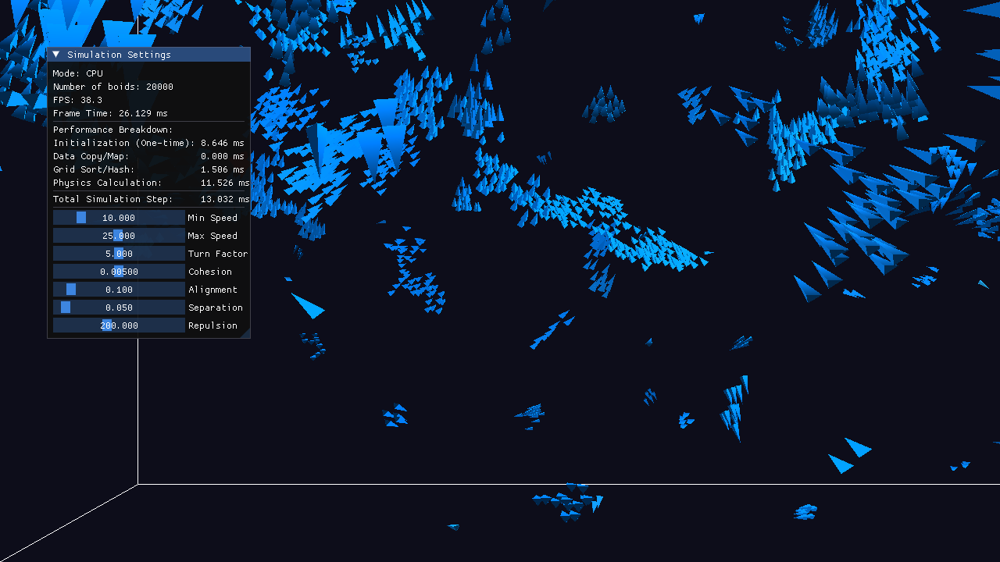

# CudaBoids3D

A 3D flocking simulation (boids) written in C++ and CUDA, rendered in real time with OpenGL.
The same model runs either on the CPU or on the GPU, so the two can be compared side by side.
Besides regular fish there are a few sharks: fish flee from them, and the user can push the
flock away with the mouse.



*20 000 boids after about 30 seconds of simulation (CPU mode, software renderer).*

## How it works

Every boid follows Craig Reynolds' three rules, computed from the boids within its visual range:

- **Separation**: move away from boids that are closer than the protected range.
- **Alignment**: steer towards the average velocity of the neighbours.
- **Cohesion**: steer towards the centre of mass of the neighbours.

On top of that, boids turn back when they get close to the walls of the box, fish run away from
sharks they can see, sharks wander in a random direction that changes every two seconds, and the
left mouse button casts a ray from the camera that repels every boid near it. Speeds are clamped
to a minimum and a maximum after all forces are applied.

Checking every pair of boids is O(N²), which stops being interactive at a few thousand boids.
Both implementations therefore use a uniform grid with a cell size equal to the largest
interaction radius. A boid only has to look at the 27 cells around its own one.

### GPU pipeline

One simulation step on the GPU is a short chain of kernels. All of them run on data that stays
in GPU memory the whole time:

1. **Map the OpenGL buffers.** Positions, velocities and types live in OpenGL vertex buffers.
   CUDA maps them through CUDA-OpenGL interop, so the renderer draws exactly what the simulation
   wrote, without copying anything through the CPU.
2. **Assign to the grid.** One thread per boid computes the index of its cell.
3. **Sort by cell.** `thrust::sort_by_key` sorts the cell indices together with the boid indices.
4. **Reorder.** Positions, velocities, types and ids are gathered into new arrays in sorted order.
   Boids that share a cell are now next to each other in memory, so the neighbour search reads
   contiguous memory instead of jumping around.
5. **Find cell ranges.** A boid whose cell differs from its predecessor marks the start of a cell,
   which gives the start and end index of every non-empty cell.
6. **Update.** One thread per boid walks the 27 neighbouring cells, accumulates the three rules
   and writes the new position and velocity straight back into the OpenGL buffers.

The data is kept as a structure of arrays (separate `x`, `y`, `z` arrays), so neighbouring
threads read neighbouring addresses. Simulation parameters live in `__constant__` memory,
because every thread reads the same values. Rendering uses instancing: one small mesh, drawn once
per boid, with the orientation computed from the velocity in the vertex shader.

The CPU version uses the same grid and the same rules in a single thread. The UI shows the time
spent in each stage (mapping, sorting, physics) for both modes, measured with CUDA events on the
GPU and `std::chrono` on the CPU.

## Building

Requirements:

- CMake 3.24 or newer
- CUDA Toolkit 12.x and a C++17 compiler (Visual Studio 2022 on Windows, GCC or Clang on Linux)
- An NVIDIA GPU to run the GPU mode (the CPU mode runs without one)
- On Linux, the X11 development packages that GLFW needs, for example on Ubuntu:
  `sudo apt install libx11-dev libxrandr-dev libxinerama-dev libxcursor-dev libxi-dev libgl-dev`

GLFW, GLM and Dear ImGui are downloaded by CMake during configuration, so nothing has to be
installed by hand. The only third-party code kept in the repository is the generated glad
OpenGL loader in `third_party/`.

```
cmake -B build
cmake --build build --config Release
```

By default the CUDA code is compiled for Turing, Ampere and Ada GPUs (compute capability 7.5,
8.6 and 8.9). To build only for the GPU in your machine:

```
cmake -B build -DCMAKE_CUDA_ARCHITECTURES=native
```

## Running

```
./build/BoidsApp                  # Linux
.\build\Release\BoidsApp.exe      # Windows
```

| Argument          | Meaning                          | Default |
| ----------------- | -------------------------------- | ------- |
| `-mode CPU\|GPU`  | where the simulation runs        | `GPU`   |
| `-n <number>`     | number of boids                  | `10000` |

Example: `BoidsApp -mode GPU -n 200000`

## Controls

| Input                          | Action                         |
| ------------------------------ | ------------------------------ |
| W / S                          | move the camera forward / back |
| A / D                          | move the camera left / right   |
| Space / Left Shift             | move the camera up / down      |
| Right mouse button + move      | look around                    |
| Mouse wheel                    | change the field of view       |
| Left mouse button              | repel boids near the cursor    |

The settings window lets you change the speeds and the weights of the rules while the
simulation is running. In GPU mode you can also change the visual range and how far fish can
see sharks; the grid is rebuilt automatically when these change.

## Project layout

```
src/main.cpp            window, camera, input, rendering, UI
src/SimulationGPU.cu    CUDA kernels and the GPU pipeline
src/SimulationCPU.cpp   CPU implementation of the same model
include/                simulation interfaces and headers
shaders/                GLSL shaders for the boids and the bounding box
third_party/            generated glad OpenGL loader
```
